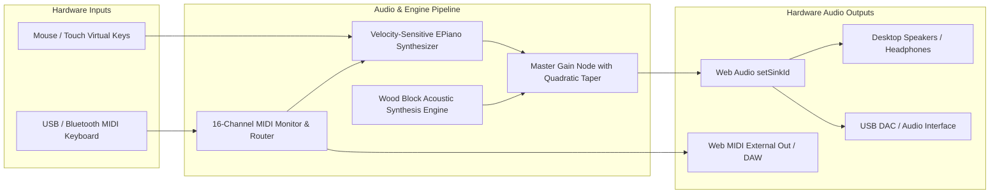

# 🎹 Piano Practice Lab & Interactive Score Reader

[](https://nodejs.org/)
[](https://developer.mozilla.org/en-US/docs/Web/API/Web_Audio_API)
[](https://developer.mozilla.org/en-US/docs/Web/API/Web_MIDI_API)
[](#technical-architecture)
[](#testing--verification)
[](LICENSE)

A modern, comprehensive, zero-dependency browser-based piano learning and practice workstation. Built with vanilla modern JavaScript, SVG score rendering, physical Web Audio synthesis, and real-time Web MIDI hardware telemetry, **Piano Practice Lab** guides players from their very first Middle C note to advanced classical repertoire, ear training mastery, and harmonic voice leading.

---

## 📑 Table of Contents

- [Overview & Vision](#-overview--vision)
- [Interactive Educational Modes](#-interactive-educational-modes)
  - [1. Repertoire Practice Lab](#1-repertoire-practice-lab)
  - [2. Sight-Reading Speed Drill](#2-sight-reading-speed-drill)
  - [3. Ear Training & Interval Gym](#3-ear-training--interval-gym)
  - [4. Scales, Chords & Theory Studio](#4-scales-chords--theory-studio)
  - [5. Rhythm & Metronome Workshop](#5-rhythm--metronome-workshop)
  - [6. Theory Lessons & Circle of Fifths](#6-theory-lessons--circle-of-fifths)
- [Persistent Interactive Docks](#-persistent-interactive-docks)
  - [3D Piano Keyboard Visualizer](#3d-piano-keyboard-visualizer)
  - [Real-Time Chord & Inversion Recognizer](#real-time-chord--inversion-recognizer)
  - [Guitar Hero / Synthesia Sustain Stage](#guitar-hero--synthesia-sustain-stage)
  - [Interactive Piano Notes Cheat Sheet Visualizer](#interactive-piano-notes-cheat-sheet-visualizer)
- [Audio & MIDI Hardware Architecture](#-audio--midi-hardware-architecture)
  - [Physical Acoustic Timbre & Synthesizer](#physical-acoustic-timbre--synthesizer)
  - [Universal Hardware Audio Output Routing (`setSinkId`)](#universal-hardware-audio-output-routing-setsinkid)
  - [16-Channel Web MIDI Telemetry & Output Dispatch](#16-channel-web-midi-telemetry--output-dispatch)
- [Music Theory Mathematical Engine (`theory.js`)](#-music-theory-mathematical-engine-theoryjs)
- [Pedagogical Repertoire Catalog (`songs.js`)](#-pedagogical-repertoire-catalog-songsjs)
- [Technical Architecture](#-technical-architecture)
- [Quick Start & Setup](#-quick-start--setup)
- [Testing & Verification](#-testing--verification)
- [Project Milestones & Tracking](#-project-milestones--tracking)

---

## 🌟 Overview & Vision

Learning to play the piano requires synchronizing four distinct cognitive faculties: **visual notation reading**, **rhythmic timing**, **auditory pitch recognition**, and **tactile motor execution**. Most software focuses on only one of these in isolation.

**Piano Practice Lab** integrates all four into a unified, responsive interface:
- **Zero Build Steps & Zero Dependencies**: Completely self-contained in clean HTML5, CSS3, and ES6+ JavaScript. Just open `index.html` in any modern web browser.
- **Hardware-Ready**: Connect any standard USB/Bluetooth MIDI keyboard for instant low-latency tactile practice, velocity sensitivity, and sustain pedal support.
- **Multi-Device Output**: Route audio directly to headphones, studio monitors, or USB DAC interfaces using native OS device pickers.
- **Pedagogical Integrity**: 56 progressively arranged pieces with conservatory-standard 12-key fingerings, harmonic Roman numeral analysis, and SMuFL classical engraving.

---

## 🎓 Interactive Educational Modes

```mermaid
flowchart TD
    App[Piano Practice Lab Workstation]
    App --> M1[1. Repertoire Practice Lab]
    App --> M2[2. Sight-Reading Speed Drill]
    App --> M3[3. Ear Training Gym]
    App --> M4[4. Scales & Theory Studio]
    App --> M5[5. Rhythm & Metronome Workshop]
    App --> M6[6. Theory Lessons & Circle of 5ths]

    M1 --> M1_Wait[Wait-for-Me Practice]
    M1 --> M1_Flow[🥁 Tempo Flow Mode]
    M1 --> M1_Auto[Polyphonic Auto Preview]
    M1 --> M1_Loop[A-B Looping + Tempo Ramp]

    M2 --> M2_SRS[Adaptive Spaced Repetition]
    M2 --> M2_Blitz[60s Blitz / Sprint / Zen]

    M3 --> M3_Pitch[Single Pitch Match]
    M3 --> M3_Interval[Interval Recognition]
    M3 --> M3_Triad[Major vs Minor Triads]

    M4 --> M4_Scales[12-Key Conservatory Scales]
    M4 --> M4_Voice[Voice-Leading Gym & Inversions]

    M5 --> M5_Metro[Acoustic Wood Block Metronome]
    M5 --> M5_Sub[Equal Beat Subdivisions]
    M5 --> M5_Tap[Interactive Tap Trainer]
```



### 1. Repertoire Practice Lab
The primary performance stage featuring dynamic SVG Grand Staff rendering:
- **Wait-for-Me Practice Mode**: The playhead advances only when the correct pitch is played. Supports two-hand fulfillment, consecutive identical notes without skipping, cross-step tie curves, and classical rest holding.
- **🥁 Tempo Flow Mode**: Auto-advancing metronome-synced playhead that evaluates key strike timing with precision grading:
  - 🔥 **Perfect Timing**: $\le \pm 45\text{ms}$
  - ✨ **Good Timing**: $\le \pm 95\text{ms}$
  - ⚠️ **Early / Late**: $> 95\text{ms}$
  - ❌ **Missed**: Step unfulfilled
- **Polyphonic Auto Play Preview**: Realistic independent voice playback where held bass whole notes sustain naturally while right-hand melodic figures move independently.
- **A-B Measure Looping & Tempo Ramp**: Isolate difficult measures and configure progressive tempo ramps ($+5\text{ BPM}$ per repetition).
- **Harmonic Roman Numeral Analysis**: Functional harmonic analysis overlay on Beat 0 of each measure (e.g., $\text{I}$, $\text{IV}$, $\text{V}^7$, $\text{vi}$).
- **Non-Bouncing Viewport Auto-Scroll**: Container-isolated auto-scroll algorithm with an ergonomic reading comfort zone, eliminating Chromium SVG viewport bounce bugs.

### 2. Sight-Reading Speed Drill
A high-velocity flashcard trainer for instantaneous notation recognition:
- **Decks**: Treble Clef Primer, Bass Clef Primer, Grand Staff, Accidentals & Black Keys, and Ledger Line Extremes.
- **Drill Formats**:
  - ⏱️ **60-Second Blitz**: Animated countdown progress bar with urgent pulse warnings.
  - 🎯 **20-Card Sprint**: Quick calibration sprint.
  - 🧘 **Infinite Zen Practice**: Relaxed, un-timed study.
- **Adaptive Spaced-Repetition System (SRS)**: Algorithmic weight engine that models response latency and error frequency, drawing unmastered notes $3\times$ more frequently and displaying mastery tiers (🟢 Mastered, 🔵 Familiar, 🟡 Learning, 🔴 Needs Review).

### 3. Ear Training & Interval Gym
Develops relative pitch and auditory discrimination:
- **Mode 1: Single Pitch Match**: Listen to a mystery note and match it on your MIDI or on-screen piano.
- **Mode 2: Interval Recognition**: Ascending and descending intervals from Minor 2nds to Octaves.
- **Mode 3: Major vs. Minor Triad Quality**: Identify harmonic color and emotional timbre.
- **Visual Audio Pulse**: Animated sound wave pulse rings surrounding audio triggers during playback.

### 4. Scales, Chords & Theory Studio
Comprehensive theoretical and physical mechanics studio:
- **Submode 4A: Scale & Fingering Explorer**:
  - Covers all 12 root tonics across Major (Ionian), Natural Minor, Harmonic Minor, Major Pentatonic, Minor Pentatonic, Blues, Dorian, and Mixolydian.
  - Conservatory standard fingerings for both hands with black-key thumb avoidance rules (e.g., F Major and B-flat Major).
  - Degree-aware diatonic accidental speller guaranteeing notes step cleanly across staff lines.
- **Submode 4B: Chord Progressions & Voice-Leading Gym**:
  - Master classic archetypes: Pop Anthem ($\text{I} - \text{V} - \text{vi} - \text{IV}$), Jazz Turnaround ($\text{ii}^7 - \text{V}^7 - \text{I}^{\text{maj}7}$), Classical Cadence ($\text{I} - \text{IV} - \text{I}^{6/4} - \text{V}^7 - \text{I}$), Andalusian Cadence ($\text{i} - \text{VII} - \text{VI} - \text{V}$), and 50s Doo-Wop.
  - Mathematical semitone voice-leading solver that computes optimal triad and 7th inversions to minimize physical hand displacement:
    $$\text{Cost}(C_{\text{prev}}, C_{\text{next}}) = \sum_{i=1}^{k} |\text{midi}(C_{\text{prev}}[i]) - \text{midi}(C_{\text{next}}[i])|$$

### 5. Rhythm & Metronome Workshop
An acoustic and mechanical timing laboratory:
- **Mechanical Swinging Pendulum Visualizer**: Smooth GPU-accelerated mechanical pendulum with realistic weight bob elevation adjusted dynamically by tempo ($40\text{ to }220\text{ BPM}$).
- **5 Physical Acoustic Timbres**:
  - 🪵 **Wood Block** (Authentic resonant dual-cavity pitch transient)
  - ⏱️ **Mechanical Metronome Tick**
  - ⚡ **Digital Beep**
  - 🔔 **Cowbell / Agogô**
  - 🥁 **Drumstick / Rimshot**
- **Strictly Equal Beat Subdivisions**: Isochronous tick scheduling for Main Beats ($1\text{ div}$), Eighths ($2\text{ divs } \text{𝅘𝅥𝅮 𝅘𝅥𝅮}$), Triplets ($3\text{ divs } \text{𝅘𝅥𝅮 𝅘𝅥𝅮 𝅘𝅥𝅮}$), and 16ths ($4\text{ divs } \text{𝅘𝅥𝅯 𝅘𝅥𝅯 𝅘𝅥𝅯 𝅘𝅥𝅯}$).
- **Time Signature Engine**: Supports $4/4$, $3/4$, $2/4$, $6/8$, $3/8$, $5/4$, $7/8$, $9/8$, and $12/8$ with hierarchical auditory accents (Downbeat, Secondary accent, Regular beat, Subdivision).
- **Interactive Tap Timing Challenge**: Tap Spacebar to benchmark personal timing latency and drift against the Web Audio clock.

### 6. Theory Lessons & Circle of Fifths
Interactive reference drawer:
- **SVG Circle of Fifths**: Interactive 12-segment wheel displaying key signatures, accidentals count, and relative minor keys. One-click integration directly opens the corresponding scale in the Scale Studio.
- **Curriculum Lessons**: Staff & Clefs, Rhythm & Note Values, Ergonomics & Hand Posture, and Harmonic Dyads & Intervals.

---

## 🎹 Persistent Interactive Docks

### 3D Piano Keyboard Visualizer
- **Realistic Physical Modeling**: Ivory white keys with subtle bevels, ebony black keys with acrylic specular sheen, tactile depression travel ($3\text{px}$ drop on press), and realistic shadow compression.
- **Distinct Middle C Marker**: Ruby red marker tag anchoring the central register.
- **8 Hardware Presets**:
  - **88 Keys** (Full Concert Grand: $A0 - C8$)
  - **76 Keys** (Stage Piano: $E1 - G7$)
  - **73 Keys** (Vintage Stage: $E1 - E7$)
  - **61 Keys** (Standard Keyboard: $C2 - C7$)
  - **49 Keys** (Studio Controller: $C2 - C6$)
  - **37 Keys** (Default Practice: $C2 - C5$)
  - **32 Keys** (Mini Synth: $F2 - C5$)
  - **25 Keys** (Compact Mini: $C3 - C5$)
  - **Custom Key Count**: User-defined count and starting note with semitone/octave shift controls.
- **Keyboard Range Allowance Filtering**: Automatically filters the 56 repertoire pieces to display only songs that fit within the currently selected keyboard size, featuring 1-click **Auto-Fit Keyboard** and range badges.

### Real-Time Chord & Inversion Recognizer
The `#activeChordPill` displays polyphonic chord identification in real-time without clobbering single notes:
- **Recognized Voicings**:
  - Octaves and Unisons across registers (e.g., $C3 + C4 \to \text{C Octave}$)
  - Power Chords & Inversions ($C3 + G3 \to \text{C5}$, $G3 + C4 \to \text{C5 / G}$)
  - Major & Minor Triads in Root, 1st, and 2nd Inversions ($C/E$, $C/G$, $Am/C$, $Am/E$)
  - Diminished & Augmented Triads
  - Dominant 7th, Major 7th, Minor 7th, Diminished 7th, Half-Diminished ($m7\flat 5$), and 3rd Inversions ($G7/F$)
  - Jazz Shell Voicings without 5th ($C7\text{ (no 5th)}$, $C\text{maj}7\text{ (no 5th)}$)
  - Extended 9th Chords ($C9$, $C\text{maj}9$, $Cm9$)

### Guitar Hero / Synthesia Sustain Stage
Real-time scrolling polyphonic sustain visualizer:
- Traveling neon ribbons track key hold duration down to the millisecond.
- Color-coded by cheat sheet pitch with clef tags (e.g., `Treble Line 2`, `Bass Space 2`, `Middle C`).
- Moving glowing spark heads and beat tick markers.

### Interactive Piano Notes Cheat Sheet Visualizer
Dedicated full-screen modal faithful to standard piano pedagogical cheat sheets:
- Visual bridge connecting 22 keyboard keys ($G2\text{ to }G5$) directly to their Grand Staff noteheads.
- Authentic 7-color note coding:
  $$\text{C (Red)} \quad \text{D (Purple)} \quad \text{E (Navy)} \quad \text{F (Sky Blue)} \quad \text{G (Teal)} \quad \text{A (Peach)} \quad \text{B (Emerald)}$$
- Interactive click-to-play with guidelines and mnemonic hints ("Every Good Boy Does Fine", "All Cows Eat Grass").

---

## 🔊 Audio & MIDI Hardware Architecture



### Physical Acoustic Timbre & Synthesizer
- **Dual-Oscillator Architecture**: Combines a foundational triangle wave with a harmonic overtone sine wave.
- **Dynamic Biquad Filter Envelope**: Simulates hammer strikes with strike-velocity frequency expansion:
  $$f_{\text{cutoff}} = f_{\text{fundamental}} \times (2.5 + v_{\text{norm}} \times 6.0)$$
- **MIDI CC 64 Damper Pedal Support**: Rings sustained notes naturally with smooth exponential decay upon pedal release.

### Universal Hardware Audio Output Routing (`setSinkId`)
- Inspects and deduplicates all physical `audiooutput` hardware devices connected to the host PC.
- Categorizes devices with friendly icons: Headphones (`🎧`), Speakers (`🔊`), USB DACs/Interfaces (`🎛️`), HDMI Displays (`🖥️`), and Virtual Cables (`🔀`).
- Supports the native OS device picker (`navigator.mediaDevices.selectAudioOutput()`) and proactive device permission unlocking (`getUserMedia` unlocker) on Windows, macOS, and Linux.
- LocalStorage persistence (`piano_audio_output_device`).

### 16-Channel Web MIDI Telemetry & Output Dispatch
- **16-Channel Telemetry Grid**: Real-time signal monitors displaying note strikes and polyphonic active voice counts across all 16 MIDI channels.
- **Omni Mode & Channel Gating**: Select an individual channel or listen across Omni.
- **Hardware Output Routing**: Transmit on-screen key presses, auto-preview voices, and metronome clicks directly back out to external digital pianos, synthesizer modules, or DAWs via Web MIDI outputs.
- **Safety Panic Flush**: Transmits All Notes Off (`CC 123`), All Sound Off (`CC 120`), and Damper Off (`CC 64`) across all 16 channels upon device disconnection or playback stop.

---

## 🎼 Pedagogical Repertoire Catalog (`songs.js`)

56 pieces organized across 8 progressive curriculum levels:

| Level | Curriculum Focus | Representative Pieces |
| :--- | :--- | :--- |
| **Level 1** | Middle C Primer & Finger Isolation | *Middle C Warmup*, *Two Black Keys*, *Three Black Keys*, *Ode to Joy Primer* |
| **Level 2** | C 5-Finger Pattern & Alternating Hands | *Mary Had a Little Lamb*, *Au Clair de la Lune*, *Lightly Row*, *Jingle Bells* |
| **Level 3** | Harmonic Dyads & Left-Hand Accompaniment | *Heart and Soul Chords*, *Twinkle Twinkle Harmony*, *Brahms Lullaby Dyads* |
| **Level 4** | Extended Scale Degrees & Finger Crossings | *Für Elise Motif*, *Canon in D Bass Line*, *The Entertainer Primer* |
| **Level 5** | Minor Keys & Modal Expressions | *Scarborough Fair Primer*, *Greensleeves Primer*, *House of the Rising Sun* |
| **Level 6** | Modern & Syncopated Rhythms | *Lean on Me (Complete 24 Measures)*, *Pink Panther*, *Hallelujah* |
| **Level 7** | Two-Hand Independence & Grand Staff Harmony | *Amazing Grace (F Major)*, *Gymnopédie No. 1 (Erik Satie)*, *Bach Minuet in G* |
| **Level 8** | Classical Mastery & Conservatory Repertoire | *Für Elise (Full Bagatelle in A Minor)*, *Pachelbel Canon in D*, *Hanon Ex. No. 1* |

---

## 🛠️ Technical Architecture

```
pianoPractice/
├── index.html                 # Complete UI application, SVG score renderer & Web Audio/MIDI engine
├── theory.js                  # Music theory engine, scales, chord math, voice leading, SRS & metronome synthesis
├── songs.js                   # 56-piece pedagogical repertoire database with hand partings, ties & lyrics
├── pianoNotesCheatSheet.png   # Authentic pedagogical reference sheet for cheat visualizer
├── PLAN_TRACKING.md           # Master milestone tracking document (Milestones 1–32)
├── README.md                  # Comprehensive documentation and architecture reference
└── tests/
    ├── test_education.js      # 13 automated unit tests for theory, scales, chords, and SRS
    └── test_score_engine.js   # 31 automated integration tests for SVG rendering, audio & MIDI
```

- **`index.html`**: Zero-framework application layer containing responsive dark/light theme CSS, accessible DOM components, SVG score generation (`renderSheetMusicScore`), practice evaluation loops, Web Audio routing, and Web MIDI message dispatchers.
- **`theory.js`**: Universal module (exports to Node.js `module.exports` and browser `window.MusicTheory`) handling pitch conversions, diatonic scale spelling, conservatory fingerings, chord recognition, voice-leading optimization, SRS stats, and acoustic click synthesis.
- **`songs.js`**: Canonical song database exported as `window.SONG_DATABASE` containing time signatures, tempo, measure tokens, voice partings (`rh`, `lh`, `dyad`), fingerings, and tie annotations (`~`).

---

## 🚀 Quick Start & Setup

### 1. Running Locally (No installation required!)
Because Piano Practice Lab has zero dependencies, you can run it immediately:
- Simply double-click `index.html` to open it in Google Chrome, Microsoft Edge, Mozilla Firefox, or Apple Safari.
- Alternatively, serve it via any local web server:
  ```bash
  # Python 3
  python -m http.server 8000

  # Node.js npx
  npx serve .
  ```
  Then navigate to `http://localhost:8000` in your browser.

### 2. Connecting a MIDI Keyboard
1. Plug your USB MIDI keyboard into your computer (or pair your Bluetooth MIDI controller).
2. Open Piano Practice Lab in Chrome or Edge (Chromium browsers offer native Web MIDI support).
3. The app will automatically detect your controller. Select your keyboard from the **MIDI Controller** dropdown in the header deck.
4. Strike any key — the live amber indicator and sustain visualizer will react instantly!

### 3. Setting Up Audio Output Devices
1. In the header audio deck, locate the **Audio Output** selector.
2. Select your desired output (Headphones `🎧`, Studio Monitors `🔊`, or USB Interface `🎛️`).
3. Click the **Chime (`🔔`)** button to test sound routing.
4. If a device name is masked by browser privacy restrictions, click **`🔍 Discover All Devices`** or **`✨ Open System Device Picker`** to grant permission.

---

## 🧪 Testing & Verification

Piano Practice Lab features an automated Node.js test harness covering the music theory mathematics, SVG layout geometry, audio gain structures, and score alignment algorithms.

To run the automated test suites:

```bash
# Run the core music theory & educational engine tests (13 tests)
node tests/test_education.js

# Run the score engine, SVG rendering & MIDI integration tests (31 tests)
node tests/test_score_engine.js

# Run both suites sequentially (Windows PowerShell syntax)
node tests/test_education.js ; node tests/test_score_engine.js
```

### Test Coverage Highlights
- ✅ **Enharmonic Spelling & Fingerings**: Validates conservatory fingerings across all 12 Major and Minor keys without staff collisions.
- ✅ **Grand Staff Alignment**: Beat-synchronized two-hand alignment across all 56 repertoire pieces.
- ✅ **SMuFL Rest Rendering**: SVG path geometry validation for quarter, half, whole, and eighth rests.
- ✅ **Cross-Step Ties**: Verifies quadratic bezier tie arcs and practice holding fulfillment.
- ✅ **Non-Bouncing Viewport**: Asserts container-isolated scroll math and absence of viewport bounce bugs.
- ✅ **Acoustic Metronome**: Isochronous tick interval verification across all meters and beat subdivisions.
- ✅ **Multi-Device Output & MIDI**: Bitwise MIDI message validation and Web Audio `setSinkId` pipeline wiring.

---

## 📈 Project Milestones & Tracking

All architectural phases, algorithmic fixes, and feature milestones are recorded in [`PLAN_TRACKING.md`](PLAN_TRACKING.md).

- **Milestones 1–5**: Core theory engine, initial practice modes, and Node.js test harness.
- **Milestones 6–12**: Bass clef alignment, note attack lifecycle, universal master volume, independent polyphonic voice sustaining, customizable key count, and 16-channel MIDI telemetry.
- **Milestones 13–18**: Conservatory fingerings, velocity-sensitive electric piano synth, CC 64 sustain, beat-proportional score spacing, voice-leading gym, and polyphonic chord recognizer.
- **Milestones 19–24**: SMuFL vector rests, full 24-measure *Lean on Me* transcription, SVG tie arcs, non-bouncing viewport auto-scroll, and keyboard size song allowance engine.
- **Milestones 25–30**: Interactive Piano Notes Cheat Sheet, equal beat subdivision metronome, hardware audio output routing (`setSinkId`), and acoustic wood block synthesis.
- **Milestones 31–32**: Codebase cleanup, 3D visual expansion, mechanical metronome pendulum, and comprehensive documentation.

---

## 📄 License

This project is open-source and available under the [MIT License](LICENSE).
Feel free to use it for personal practice, classroom teaching, or conservatory study!
